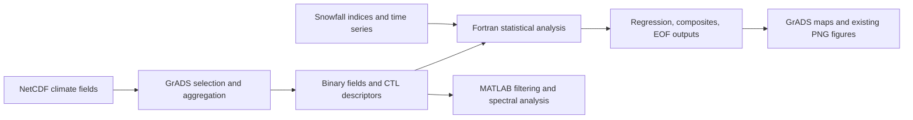

<div align="center">


# 기후 변동성 분석

**해양 · 대기 · 해빙 · 강설**  
전북대학교 관련 기후 분석 연구·수업 자료 아카이브


[English](README.md) · **한국어** · [공동 졸업논문](#thesis)

</div>

## About · 프로젝트 소개

이 저장소는 Fortran 수치 계산 코드, GrADS 전처리·시각화 스크립트, MATLAB 시계열 분석 코드와 입력 자료·중간 산출물·기존 결과 그림을 함께 보존한 기후 분석 아카이브입니다. 주요 분석은 **전주 지역의 강설일수·적설심과 해수면 온도(SST), 대기 순환, 해빙의 관계**를 다루며, 기후 통계와 자료 처리 수업·실습도 포함합니다.

각 폴더는 개별 실험이나 과제 단위로 구성되어 있습니다. 격자 크기, 기간, 입력 파일, 이상값·추세 처리 및 통계 설정은 프로그램마다 다릅니다. 기존 파일 간 연결을 추적할 수 있도록 원본 폴더명과 연구 자료를 유지했습니다. 대학명은 저장소 소유자가 지정한 자료의 맥락을 나타내며, 대학의 공식 승인이나 배포를 의미하지 않습니다.

<a id="thesis"></a>

## 2021 공동 졸업논문

**전주시 겨울철 최심적설과 눈일수에 대한 전 지구적 메커니즘 분석**  
전북대학교 지구환경과학과 기후모델링 연구실 · 2021.11.19

오승관·윤난영·이민욱·이상학·임지영·조영표의 **6인 공동 학사학위논문**이며, 지도교수는 박종연입니다. 지역 강설 관측과 전 지구 해양·대기장을 연결한 연구로, 아래 내용은 최종 논문과 발표자료를 요약했습니다.

| 연구 단계 | 논문에 기록된 내용 |
|---|---|
| 질문 | 전주시 겨울철 최심적설과 눈일수는 어떤 해양·대기 변동과 연관되는가? |
| 입력 | **1983–2021년** 전주 기상청 최심적설·눈일수 관측과 NOAA SST, 바람, 850 hPa 기온·지오포텐셜 고도, 해빙 재분석 자료 |
| 전처리·통계 | DJF·3개월 이동평균, **0–12개월 시차 회귀장**과 시계열 분석; Fortran·GrADS 활용 |
| 모형 비교 | 강수 회귀장에서 선택한 열대 지역 강제력에 대한 **Linear Baroclinic Model(LBM)** 대기 반응과 회귀장 패턴 비교 |
| 보고된 결과 | 최심적설은 약 **8개월 전 ENSO 연관성**, 눈일수는 상대적으로 약한 관계를 보고; LBM 반응 패턴도 비교 |

원문은 관측기간을 1983–2021년, 분석자료를 38년으로 기재합니다. 연도 양끝만으로 표본 수를 다시 계산하지 않았습니다. 결과는 논문에 보고된 연관성으로, 독립적인 인과 검증이나 예측 성능 평가를 의미하지 않습니다.

<table>
<tr>
<td width="50%"><a href="https://fortranmentis.github.io/assets/research/jeonju-snow-thesis-2021.pdf#page=18"></a><p>Fig. 3 · 7–9개월 시차 회귀장 / 본문 16쪽</p></td>
<td width="50%"><a href="https://fortranmentis.github.io/assets/research/jeonju-snow-thesis-2021.pdf#page=44"></a><p>Fig. 18 · LBM·회귀장 비교 / 본문 42쪽</p></td>
</tr>
</table>

[논문 원문 PDF · 7.6 MB](https://fortranmentis.github.io/assets/research/jeonju-snow-thesis-2021.pdf) · [발표자료 PPTX · 16.6 MB](https://fortranmentis.github.io/assets/research/jeonju-snow-presentation-2021.pptx) · [포트폴리오 연구 소개](https://fortranmentis.github.io/ko/#thesis)

원문·발표자료는 별도 다운로드가 가능한 GitHub Pages 자료입니다. 그림은 최종 논문 해당 페이지 전체를 축소한 미리보기이며 내용을 다시 그리지 않았습니다. **논문의 LBM 실험을 이 저장소에서 재실행한 것은 아닙니다.** 아카이브의 EOF·합성·MATLAB 작업은 더 넓은 연구·수업 자료이며 모두 졸업논문에 사용된 방법이라는 뜻은 아닙니다. 기존 [검증 범위](VALIDATION.md)는 그대로 적용됩니다.

## Highlights · 주요 특징

| 구분 | 포함 내용 |
|---|---|
| 기후 통계 | 상관·회귀·부분회귀, 자기상관, 합성장 분석 |
| 강설과 기후장 | 강설일수·적설심과 SST, 바람, 기온, 지위고도, 해빙의 관계 분석 |
| 계절·지연 분석 | DJF·JFM·NDJ 계절 비교와 월별·지연별 입력·출력 |
| 공간 변동성 | SST EOF 계산과 고유벡터·주성분 산출물 |
| 시계열 분석 | MATLAB Lanczos 필터와 웨이블릿·스펙트럼 분석 |
| 코드·그림 | **Fortran 49개 · GrADS `.gs` 231개 · MATLAB 9개 · PNG 261개** |
| 자료 추적 | **CTL 613개 · NetCDF 28개 · `.gdat` 872개**, 파일별 SHA-256 및 참조 점검표 |

## Gallery · 기존 결과 그림

<table>
  <tr>
    <td width="50%"></td>
    <td width="50%"></td>
  </tr>
  <tr><td>원본 그림 표기: 전주 적설심, SST·바람, 1월.</td><td>원본 그림 표기: 전주 강설일수, 해빙·850 hPa 기온, JFM 지연 −11.</td></tr>
</table>

기존 그림을 시각적으로 확인해 수록했습니다. 그림을 재생성하거나 과학적으로 독립 검증한 것은 아닙니다. 지연 방향, 유의성 표기, 변수 단위는 해당 코드와 함께 확인해야 합니다.

## Architecture · 분석 구성



코드에서 확인되는 작업 흐름을 정리한 것으로, 전체를 실행하는 단일 자동화 파이프라인은 없습니다.

## GrADS scripts · .gs 파일의 역할과 실행

**`.gs` 231개**는 기후 원자료와 Fortran 계산, 결과 그림을 연결합니다. 공간·기간 선택, 월별 기후 평균과 편차 계산, 계절·영역 지수 생성, 바이너리 입력 저장, 통계 결과의 지도 작성까지 담당합니다. 별도로 `.gsf` 함수 파일 1개가 있습니다.

| 역할 | 대표 파일 | 확인할 내용 |
|---|---|---|
| 기후장 전처리 | [`nonmunJFM/make_data_sst.gs`](nonmunJFM/make_data_sst.gs), [`make_sst_jan/mk_data_sst.gs`](make_sst_jan/mk_data_sst.gs) | NetCDF 입력, 월별 기준 평균, 편차, 연도별 추출, `.gdat` 저장 |
| 기후 지수 생성 | [`regression/mk_Nino_index.gs`](regression/mk_Nino_index.gs) | 190–240°E·5°S–5°N 영역 평균, 월별 편차, 12월 중심 3개월 평균 |
| 통계 확인 | [`regression/reg_btw2ts.gs`](regression/reg_btw2ts.gs), [`regression/draw_scatter.gs`](regression/draw_scatter.gs) | 회귀 기울기 수식과 두 지수의 산점도 |
| 회귀 지도 | [`2001jjSSTwind/draw_reg_snow_sst.gs`](2001jjSSTwind/draw_reg_snow_sst.gs) | SST·동서풍·남북풍 입력, 파일 번호, 음영·벡터·확률 마스크, PNG 출력 |
| 공간 모드 | [`EOF/draw_eof.gs`](EOF/draw_eof.gs) | EOF1·EOF2 공간장, PC1·PC2 시계열, 고유값 비율과 패널 배치 |
| 시각화 보조 | `basemap.gs`, `cbarm.gs`, `clevsjy*.gs`, `dots.gs`, `subplot.gs` | 지도 마스크, 컬러바, 색상 구간, 점 표시와 다중 패널 |
| 추세 함수 | [`snow/ltrend.gs`](snow/ltrend.gs), [`snow/qdims.gsf`](snow/qdims.gsf) | 선형 추세 계산, 차원 조회, `.gs`와 `.gsf`의 연결 |

예를 들어 `nonmunJFM/make_data_sst.gs`는 SST를 열고 월별 기후 평균을 구한 뒤 편차와 중심 3개월 평균을 계산합니다. 이후 1983–2020년의 2월 중심 값을 `sst_JFM_-12.gdat`에 저장하므로 실제 평균 월은 1–3월입니다. 파일명의 지연 표기는 후속 강설 지수의 기준 연도와 별도로 맞춰야 합니다. 이 전처리 설정이 Fortran 분석 결과의 의미를 결정합니다.

실행은 실험 폴더에서 **GrADS를 시작한 뒤** 진행합니다.

```bash
cd EOF
grads -l
```

GrADS 프롬프트에서 `run draw_eof.gs`를 입력합니다. 이 예제는 같은 폴더의 `subplot.gs`를 이용해 저장된 EOF 결과를 표시하며, EOF 자체를 다시 계산하지 않습니다.

[상세 한국어 가이드](docs/GRADS_GUIDE.ko.md)에 명령문과 스크립트 변수의 차이, 입력·출력 흐름, 파일 번호, 바이너리 형식, 보조 함수와 실행 절차를 정리했습니다. [English guide](docs/GRADS_GUIDE.md)도 제공합니다.

**정적 경로 점검:** 인식한 `open`·`sdfopen`·`xdfopen` 명령 147건 중 스크립트 폴더 기준 존재 97건, 환경별 절대경로 40건, 없는 상대경로 10건입니다. 이는 CTL 613개의 데이터 참조가 모두 존재한다는 점검과 별개입니다. CTL이 유효해도 `.gs`에서 다른 CTL이나 경로를 열면 실행되지 않습니다. GrADS 실행 자체는 미검증입니다.

[전체 스크립트 목록](docs/grads_scripts.csv), [입력 경로 점검표](docs/grads_input_references.csv), [정적 점검 요약](docs/grads_audit.json)을 제공합니다. `.gs`·`.gsf` 232개에 대한 역할 분류는 보조 함수 119개, 자료 저장·혼합 작업 47개, 분석·표시 66개이며, 전체 언어 구문을 해석한 결과는 아닙니다.

## Repository map · 폴더 안내

| 폴더 | 역할 |
|---|---|
| [`Data/`](Data/), [`mean/`](mean/), [`make_sst_jan/`](make_sst_jan/) | 공통 기후장, 기후 평균·편차, SST 전처리 |
| [`correlation/`](correlation/), [`regression/`](regression/), [`partial_regression/`](partial_regression/) | 상관·회귀·부분회귀 분석 |
| [`auto_correlation/`](auto_correlation/), [`composite/`](composite/), [`EOF/`](EOF/) | 자기상관, 합성장, 공간 모드 분석 |
| `snow/`, `snow2/`, `snow3/` | 강설 관련 지수와 분석 실험 |
| [`snowday_reg/`](snowday_reg/), [`snowday_comp/`](snowday_comp/) | 강설일수 회귀·합성장 분석 |
| [`snowdepth_reg/`](snowdepth_reg/), [`snowdepth_comp/`](snowdepth_comp/) | 적설심 회귀·합성장 분석 |
| [`snowday_reg_sea_ice/`](snowday_reg_sea_ice/), [`snowdepth_reg_sea_ice/`](snowdepth_reg_sea_ice/) | 강설과 해빙 관계 분석 |
| `icec/`, `icec_day/`, `icec_depth/`, `icec_snowday/`, `icec_snowdepth/` | 해빙 중심 실험과 지도 작성 |
| `2001air/`, `2001geo/`, `2001sst/`, `2001wind/` 및 관련 `2001*` 폴더 | 개별 실험의 기후장·회귀·시각화 |
| `nonmun/`, `nonmun2/`, `nonmunDJF/`, `nonmunJFM/`, `nonmunNDJ/`, `JFM/` | 연구 작업 자료와 계절별 비교 |
| `FInal/`, `gisang/`, `gragh/`, `jet/` | 추가 기후장 전처리·시각화·분석 |
| [`spectral analysis/`](spectral%20analysis/) | MATLAB 필터·웨이블릿·스펙트럼 분석 및 Fortran 코드 |
| `homework/`, `homework2/`, `homework_3/`, `test/`, `test2/`, `test111/` | 수업 과제와 탐색 실험 |
| [`docs/`](docs/), [`tools/`](tools/) | 검증 근거, 파일 목록, 재실행 가능한 점검 스크립트 |

## Quick start · 시작하기

### 1. Git LFS로 자료 받기

```bash
git lfs install
git clone https://github.com/fortranmentis/climate-variability-analysis_Jeonbuk-National-University.git
cd climate-variability-analysis_Jeonbuk-National-University
git lfs pull
```

원본 중 실행파일·임시파일을 제외한 **2,126개, 약 5.72GB**의 연구 자료를 포함합니다. `.nc`, `.gdat`, `.fwrite`는 Git LFS로 관리합니다. 원본 스냅샷 기준 LFS 경로는 901개이며 중복을 제거한 실제 내용은 약 **3.84GB**입니다. Git LFS 이용 가능 여부와 계정 할당량에 따라 다운로드가 제한될 수 있습니다. 데이터 대신 짧은 LFS 포인터 텍스트만 있는 상태에서는 분석을 실행할 수 없습니다.

소스와 그림부터 가볍게 살펴보려면 PowerShell에서 다음처럼 받습니다.

```powershell
$env:GIT_LFS_SKIP_SMUDGE = "1"
git clone https://github.com/fortranmentis/climate-variability-analysis_Jeonbuk-National-University.git
Remove-Item Env:GIT_LFS_SKIP_SMUDGE
```

### 2. 확인한 회귀 예제 실행

GNU Fortran 설치와 `regression/`의 LFS 입력 파일 2개가 필요합니다.

```bash
cd regression
gfortran -O0 -fcheck=all -o reg_btw2ts reg_btw2ts.f90
./reg_btw2ts
```

Windows에서는 출력명을 `reg_btw2ts.exe`로 지정하고 `.\reg_btw2ts.exe`로 실행합니다. 컴파일러 런타임 DLL을 찾지 못한다면 지원되는 환경에서 `-static` 옵션을 사용할 수 있습니다. 새 실행파일은 Git에 추가하지 않습니다.

이 예제는 1982–2018년의 NDJ Niño 지수와 전주 12월 강수량 37개 값을 비교합니다. 로컬에서 런타임 점검 옵션을 켜고 실행한 결과, 회귀계수 약 **6.73314**, 코드가 출력한 확률값 약 **0.00526656**을 얻었습니다. 이는 기존 구현의 제한적인 실행 확인이며, 과학적 타당성이나 전체 결과 재현을 뜻하지 않습니다.

### 3. 다른 실험 실행 전 확인

1. 같은 폴더의 `.f90`, `.gs`, `.ctl`을 함께 검토합니다.
2. 입력명, `lx`·`ly`·`lt`/`nt`, `UNDEF`, 추세 제거와 평균·편차 설정을 확인합니다.
3. 연도를 넘는 계절과 지연 방향을 포함해 지수와 기후장의 시간축을 맞춥니다.
4. `/home/...` 절대경로를 수정하고 해당 실험 폴더에서 실행합니다.
5. 원본 결과를 보존하도록 폴더 복사본에서 시험 실행합니다.

`.gs`는 GrADS, `.m`은 MATLAB 환경이 필요합니다. MATLAB/Octave 호환성은 확인하지 않았습니다. `rgbset_mod` 같은 외부 시각화 보조 함수도 실행 전에 확인해야 합니다.

## Data contract · 자료 해석 기준

| 항목 | 확인할 내용 |
|---|---|
| NetCDF | 파일별 변수·좌표·단위·결측값·자료 출처 |
| `.gdat`와 `.ctl` | 바이너리 자료와 별도 메타데이터를 한 쌍으로 유지 |
| 바이너리 형식 | 확인한 Fortran은 4바이트 값을 전제로 한 direct-access unformatted I/O 사용; 정밀도·엔디언·레코드 길이·변수 순서 확인 |
| 분석 기간 | 1982–2018, 1984–2021, 1981–2021 등 실험마다 다름 |
| 계절 | DJF: 12–2월, JFM: 1–3월, NDJ: 11–1월; 기준 연도 지정 방식 확인 |
| 결측값 | 분석 바이너리에는 `-9.99e8`이 자주 사용되며 원본 NetCDF의 fill value·packing은 별도 확인 |
| 통계 변수명 | `reg=1`이면 `corr`라는 필드에도 회귀계수가 저장될 수 있음 |

## Validation · 검증 범위

| 점검 | 결과 |
|---|---|
| 원본 목록 | 2,160개 파일의 SHA-256 기록, 실행파일·편집기 임시파일 34개 제외 |
| CTL 참조 | **613개 모두** `DSET` 대상 파일 존재 확인 |
| NetCDF 헤더 | classic NetCDF **15개** 메타데이터 확인, HDF 서명 **13개**는 NetCDF4/HDF5 리더를 통한 추가 검증 필요 |
| Fortran 문법 | 기본 옵션 **48/49개** 통과, 나머지 1개는 `-ffree-line-length-none` 적용 시 통과 |
| 수치 실행 | 회귀 예제 1개 컴파일·실행 및 런타임 점검 통과 |
| 전체 재현 | GrADS 그림 재생성, MATLAB 실행, 전체 파이프라인, 통계 가정과 독립 결과 재현은 미검증 |

상세 근거는 [VALIDATION.md](VALIDATION.md), [자료 요약](docs/archive_audit.json), [파일별 해시](docs/archive_inventory.csv), [CTL 참조표](docs/ctl_references.csv), [NetCDF 메타데이터](docs/netcdf_metadata.json), [컴파일 점검](docs/fortran_syntax.json), [회귀 실행 기록](docs/regression_smoke.json)에 있습니다.

## Notes · 사용 시 참고

- 원본 폴더·파일명, 중복 자료, 실험별 설정을 유지했습니다. 전체 실행기나 고정된 환경 명세는 없습니다.
- 일부 스크립트의 `/home/...` 경로는 현재 환경에 맞춰 수정해야 합니다.
- 파일명과 변수 의미가 다를 수 있습니다. 예를 들어 `snowday_reg/draw_corr_snow_sst.gs`는 `snowdepth`가 포함된 그림 파일명을 사용합니다.
- 상관·회귀는 연관성을 나타냅니다. 유의성은 전처리, 시계열 의존성, 표본 수, 다중검정의 영향을 받으므로 저장된 확률값만으로 과학적 결론을 확정할 수 없습니다.
- NetCDF 속성과 소스 주석에 출처가 일부 남아 있지만 관측소 지수 수집 이력, 자료 버전과 산출 정의는 일관되게 문서화되어 있지 않습니다.
- 원저자·외부 코드의 권리 고지를 보존했습니다. 저장소 전체에 임의의 소프트웨어·데이터 라이선스를 부여하지 않았습니다. 재배포·논문 이용 전 [자료와 재사용 안내](docs/DATA_AND_REUSE.md)를 확인하세요.

## Next steps · 향후 정비 방향

- 절대경로와 반복 설정을 실험별 명시적 설정으로 분리
- 관측소 식별자, 지수 정의, 자료 버전, 계절별 시간 정렬 규칙 문서화
- 독립적인 수치 검증과 대표 그림 재생성 환경 기록
- 실험별 입력 동일성을 확인한 뒤 중복 자료 정리

---

[English](README.md) · [검증 근거](VALIDATION.md) · [자료와 재사용](docs/DATA_AND_REUSE.md)

