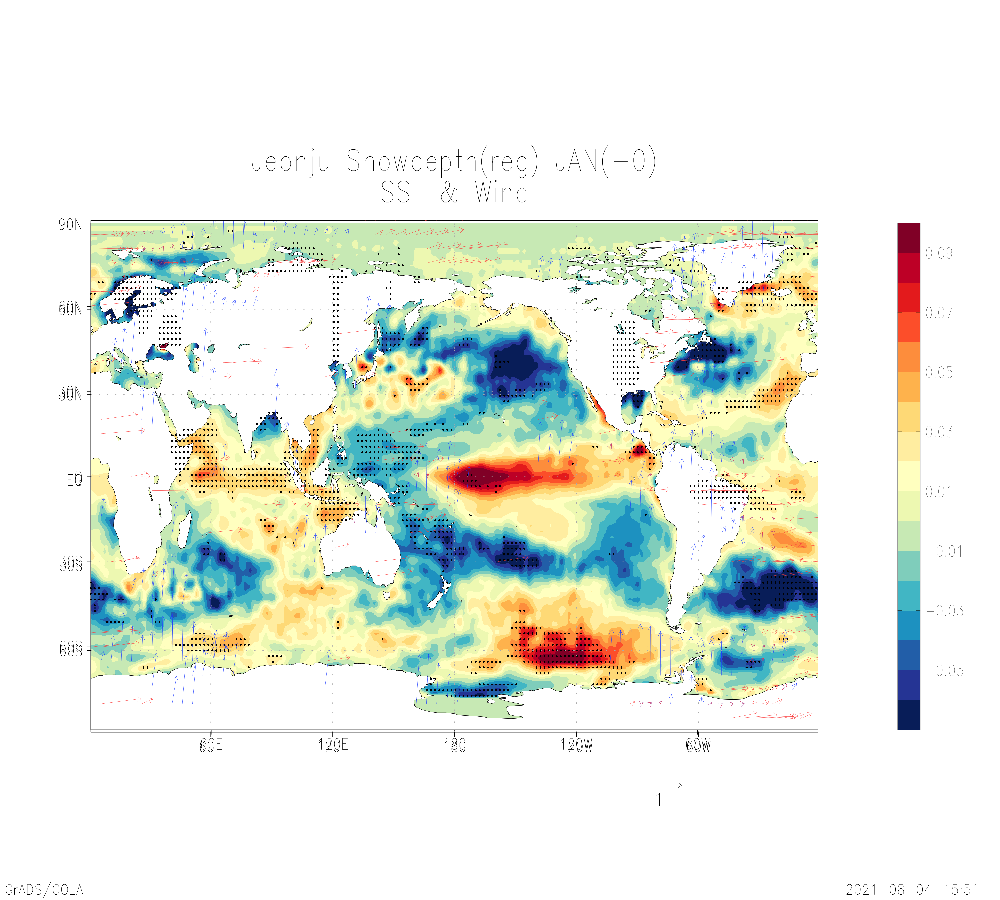
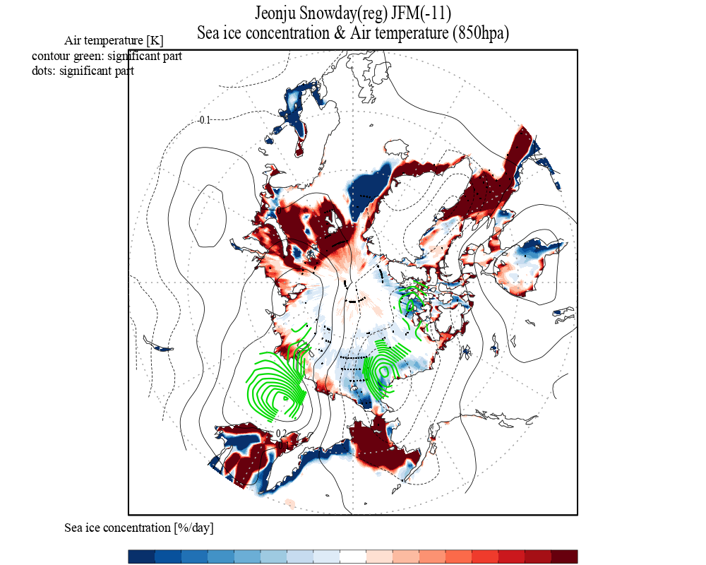
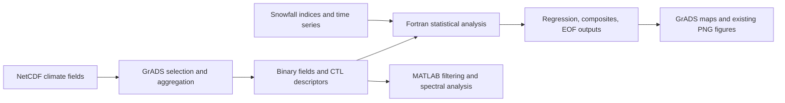

<div align="center">


# Climate Variability Analysis

**Ocean · Atmosphere · Sea ice · Snowfall**  
Research and coursework archive associated with Jeonbuk National University


**English** · [한국어](README.ko.md)

[About](#about) · [Highlights](#highlights) · [Thesis](#thesis) · [Gallery](#gallery) · [GrADS scripts](#grads-scripts) · [Quick start](#quick-start) · [Validation](#validation) · [Notes](#notes)

</div>

## About

This repository preserves a working archive of climate data analysis: Fortran numerical programs, GrADS preprocessing and plotting scripts, MATLAB time-series routines, input datasets, intermediate binary fields, and existing figures. Its main research threads connect **Jeonju snowfall and snow depth** with **sea surface temperature, atmospheric circulation, and sea ice**; related directories contain climatology and statistical analysis exercises.

The archive is organized by experiment and course task. Individual programs carry their own grid dimensions, time windows, input names, preprocessing choices, and statistical settings. The original directory names and research files are retained so that existing descriptors and relative paths remain traceable. The university name identifies the archive context supplied by the repository owner; it does not imply institutional endorsement.

<a id="thesis"></a>

## 2021 undergraduate thesis

**전주시 겨울철 최심적설과 눈일수에 대한 전 지구적 메커니즘 분석**  
Descriptive translation: *Global mechanisms associated with winter snow depth and snow days in Jeonju*  
Climate Modeling Laboratory, Department of Earth and Environmental Sciences, Jeonbuk National University · November 19, 2021

A **six-author undergraduate thesis** by 오승관, 윤난영, 이민욱, 이상학, 임지영 and 조영표, supervised by 박종연. The final thesis and presentation connect local snow observations with global ocean–atmosphere variability. The study is not presented as sole-authored work.

| Research step | Documented in the thesis |
|---|---|
| Question | Which ocean–atmosphere variations are associated with Jeonju winter maximum snow depth and snow days? |
| Inputs | **1983–2021** KMA Jeonju snow-depth/snow-day observations and NOAA SST, winds, 850 hPa temperature/geopotential height and sea-ice reanalysis |
| Processing and statistics | DJF/three-month means, **0–12-month lagged regression fields** and time series; Fortran and GrADS |
| Model comparison | **Linear Baroclinic Model (LBM)** responses to tropical forcing selected from precipitation regression fields, compared with atmospheric regression patterns |
| Reported findings | An ENSO association at roughly **eight months’ lead** for maximum snow depth, a weaker relationship for snow days, and comparisons with LBM response patterns |

The source specifies 1983–2021 and describes 38 years of analysis data; sample size is not recalculated from endpoint years. These are reported statistical relationships, not independent causal validation or evaluated predictive skill.

<table>
<tr>
<td width="50%"><a href="https://fortranmentis.github.io/assets/research/jeonju-snow-thesis-2021.pdf#page=18"></a><p>Fig. 3 · Regression fields at 7–9-month lags / printed page 16</p></td>
<td width="50%"><a href="https://fortranmentis.github.io/assets/research/jeonju-snow-thesis-2021.pdf#page=44"></a><p>Fig. 18 · LBM and regression comparison / printed page 42</p></td>
</tr>
</table>

[Original thesis PDF · 7.6 MB](https://fortranmentis.github.io/assets/research/jeonju-snow-thesis-2021.pdf) · [Presentation PPTX · 16.6 MB](https://fortranmentis.github.io/assets/research/jeonju-snow-presentation-2021.pptx) · [Portfolio research overview](https://fortranmentis.github.io/#thesis)

The original documents are hosted on GitHub Pages and can be downloaded separately. Previews show whole pages from the final thesis without redrawing their scientific content. **The thesis LBM experiment has not been rerun from this repository.** EOF, composite and MATLAB work belongs to the wider research/coursework archive; it is not all attributed to the thesis. Existing [validation limits](VALIDATION.md) still apply.

## Highlights

| Research capability | Evidence in the archive |
|---|---|
| Climate statistics | Correlation, regression, partial regression, autocorrelation, and composite directories |
| Snow–ocean–atmosphere relationships | Snow-day and snow-depth experiments with SST, wind, air temperature, geopotential height, and sea ice |
| Seasonal and lagged comparisons | DJF, JFM, NDJ directories and month/lag-specific input and output files |
| Spatial variability | SST empirical orthogonal function (EOF) program, eigenvector fields, and principal-component outputs |
| Time-series methods | MATLAB Lanczos filtering, wavelet, and spectral analysis routines |
| Inspectable artifacts | **49 Fortran sources · 231 GrADS `.gs` scripts · 9 MATLAB files · 261 PNG figures** |
| Data traceability | **613 GrADS descriptors · 28 NetCDF files · 872 `.gdat` files**, with file hashes and descriptor-reference audits |

## Gallery

Existing figures are presented as archived outputs. They were inspected visually, but have not been regenerated or independently validated scientifically.

<table>
  <tr>
    <td width="50%"></td>
    <td width="50%"></td>
  </tr>
  <tr>
    <td>Jeonju snow depth, SST, and wind — January, as labeled in the original figure.</td>
    <td>Jeonju snow days, sea ice, and 850 hPa air temperature — JFM lag −11, as labeled in the original figure.</td>
  </tr>
</table>

Figure titles, significance annotations, and lag labels are preserved from the archive. Interpret their definitions against the corresponding scripts before reuse.

## Analysis flow



This describes the patterns visible in the scripts. It is not a single automated pipeline.

## GrADS scripts

The **231 `.gs` files** are the bridge between climate datasets, Fortran calculations, and scientific figures. They select spatial/time domains, calculate climatologies and anomalies, form seasonal or regional indices, export binary inputs, and render statistical outputs. One additional `.gsf` file supplies a script function.

| Role | Representative scripts | What to inspect |
|---|---|---|
| Climate-field preparation | [`nonmunJFM/make_data_sst.gs`](nonmunJFM/make_data_sst.gs), [`make_sst_jan/mk_data_sst.gs`](make_sst_jan/mk_data_sst.gs) | NetCDF input, monthly baseline, anomaly definition, annual sampling, `.gdat` output |
| Climate indices | [`regression/mk_Nino_index.gs`](regression/mk_Nino_index.gs) | Area mean over 190–240°E, 5°S–5°N, monthly anomalies, and December-centered three-month averages |
| Statistical inspection | [`regression/reg_btw2ts.gs`](regression/reg_btw2ts.gs), [`regression/draw_scatter.gs`](regression/draw_scatter.gs) | Regression-slope expression and paired-index scatterplot |
| Regression maps | [`2001jjSSTwind/draw_reg_snow_sst.gs`](2001jjSSTwind/draw_reg_snow_sst.gs) | Three opened fields, dataset suffixes, shaded SST, vector layer, probability masks, PNG export |
| Spatial modes | [`EOF/draw_eof.gs`](EOF/draw_eof.gs) | EOF1/EOF2 patterns, PC1/PC2 series, eigenvalue percentages, and panel layout |
| Shared plotting functions | `basemap.gs`, `cbarm.gs`, `clevsjy*.gs`, `dots.gs`, `subplot.gs` | Map masks, color scales, significance dots, palettes, and figure layout |
| Trend functions | [`snow/ltrend.gs`](snow/ltrend.gs), [`snow/qdims.gsf`](snow/qdims.gsf) | Fitted trend, dimension queries, and the `.gs`/`.gsf` dependency |

For example, `nonmunJFM/make_data_sst.gs` opens SST, constructs a calendar-month climatology, subtracts it, computes a centered three-month average, and writes February samples for 1983–2020 to `sst_JFM_-12.gdat`. The February center makes these January–March means; the filename's lag label still needs alignment with the downstream snow index. These preprocessing choices determine the scientific meaning of subsequent Fortran results.

Run scripts **inside GrADS**, from their experiment directory:

```bash
cd EOF
grads -l
```

At the GrADS prompt, use `run draw_eof.gs`. This example displays archived EOF outputs using the local `subplot.gs`; it does not recompute EOFs. The [detailed guide](docs/GRADS_GUIDE.md) explains quoted commands versus script variables, file numbering, output formats, helper lookup, and reproducible run procedures. An equivalent [한국어 가이드](docs/GRADS_GUIDE.ko.md) is available.

**Static path audit:** 147 recognized `open`/`sdfopen`/`xdfopen` command occurrences include 97 paths present relative to their script directory, 40 workstation-specific absolute paths, and 10 absent relative targets. This is distinct from the successful CTL-to-data audit: a valid descriptor does not guarantee that a script opens the correct descriptor. GrADS execution remains untested.

Browse the [complete script catalogue](docs/grads_scripts.csv), [input-reference audit](docs/grads_input_references.csv), and [scan summary](docs/grads_audit.json). Role hints classify 119 helper files, 47 data-export/mixed workflows, and 66 analysis/display scripts across the 232 `.gs`/`.gsf` files; the scan is not a full language parser.

## Repository map

| Directory group | Purpose |
|---|---|
| [`Data/`](Data/) | Shared SST, precipitation, and wind NetCDF files and plotting helpers |
| [`mean/`](mean/), [`make_sst_jan/`](make_sst_jan/) | Climatology, anomaly plotting, and SST preparation |
| [`correlation/`](correlation/), [`regression/`](regression/), [`partial_regression/`](partial_regression/) | Statistical examples and climate-index relationships |
| [`auto_correlation/`](auto_correlation/), [`composite/`](composite/), [`EOF/`](EOF/) | Autocorrelation, composite, and spatial-mode analysis |
| [`snow/`](snow/), [`snow2/`](snow2/), [`snow3/`](snow3/) | Snow indices and related preparation and analysis experiments |
| [`snowday_reg/`](snowday_reg/), [`snowday_comp/`](snowday_comp/) | Snow-day regression and composite experiments |
| [`snowdepth_reg/`](snowdepth_reg/), [`snowdepth_comp/`](snowdepth_comp/) | Snow-depth regression and composite experiments |
| [`snowday_reg_sea_ice/`](snowday_reg_sea_ice/), [`snowdepth_reg_sea_ice/`](snowdepth_reg_sea_ice/) | Snow–sea-ice relationships and supporting fields |
| [`icec/`](icec/), `icec_day/`, `icec_depth/`, `icec_snowday/`, `icec_snowdepth/` | Sea-ice-centered experiments and figure scripts |
| `2001air/`, `2001geo/`, `2001sst/`, `2001wind/` and related `2001*` directories | Experiment-specific fields, regression programs, and maps |
| `nonmun/`, `nonmun2/`, `nonmunDJF/`, `nonmunJFM/`, `nonmunNDJ/`, [`JFM/`](JFM/) | Research working directories and seasonal comparisons |
| [`FInal/`](FInal/), `gisang/`, `gragh/`, `jet/` | Additional climate-field preparation, plotting, and working analyses |
| [`spectral analysis/`](spectral%20analysis/) | MATLAB filtering and wavelet/spectral examples, plus Fortran correlogram code |
| `homework/`, `homework2/`, `homework_3/`, `test/`, `test2/`, `test111/` | Course exercises and exploratory work |
| [`docs/`](docs/), [`tools/`](tools/) | Publication audit evidence and a rerunnable archive inspection script |

## Quick start

### 1. Retrieve the data with Git LFS

```bash
git lfs install
git clone https://github.com/fortranmentis/climate-variability-analysis_Jeonbuk-National-University.git
cd climate-variability-analysis_Jeonbuk-National-University
git lfs pull
```

The preserved archive contains **2,126 files totaling 5.72 GB** before Git/LFS storage deduplication. NetCDF, `.gdat`, and `.fwrite` files use Git LFS. The original snapshot has 901 LFS-managed paths with approximately **3.84 GB of distinct payloads**. Git LFS availability and account quotas affect data downloads. A checkout containing LFS pointer text is not ready for numerical analysis.

For source and figure browsing with a smaller download:

```bash
GIT_LFS_SKIP_SMUDGE=1 git clone https://github.com/fortranmentis/climate-variability-analysis_Jeonbuk-National-University.git
# PowerShell: set $env:GIT_LFS_SKIP_SMUDGE = "1" before cloning;
# remove it afterward with Remove-Item Env:GIT_LFS_SKIP_SMUDGE.
```

### 2. Run one inspected numerical example

Requirements: GNU Fortran and the two LFS input files in `regression/`.

```bash
cd regression
gfortran -O0 -fcheck=all -o reg_btw2ts reg_btw2ts.f90
./reg_btw2ts
```

On Windows, use `-o reg_btw2ts.exe` and run `.\reg_btw2ts.exe`. If the compiler's runtime DLLs are unavailable, a locally supported `-static` build can be used. Keep newly compiled binaries out of version control.

The archived configuration compares 37 NDJ Niño-index values with December precipitation at Jeonju for 1982–2018. A local checked build returned a regression coefficient of approximately **6.73314** and a reported probability of **0.00526656**. This is a limited execution check of the existing implementation; see [VALIDATION.md](VALIDATION.md) for its interpretation and scope.

### 3. Inspect and adapt other experiments

1. Open the experiment's `.f90`, `.gs`, and `.ctl` files together.
2. Check input filenames, `lx`, `ly`, `lt`/`nt`, `UNDEF`, detrending, and anomaly settings.
3. Align the index years with the climate-field years, including cross-year seasons and lag direction.
4. Replace workstation-specific paths, then run from the experiment directory.
5. Write trial outputs into a copy of that directory to preserve the archived results.

GrADS is required for `.gs` workflows; MATLAB is required for the supplied `.m` workflows. MATLAB/Octave compatibility has not been tested. Some plotting scripts call external helpers such as `rgbset_mod`; resolve these before attempting figure regeneration.

## Data contract

| Item | Interpretation and checks |
|---|---|
| `.nc` | Climate source fields; inspect each file's variables, coordinates, units, missing values, and provenance |
| `.gdat` + `.ctl` | Binary values with a separate GrADS descriptor; keep each pair together |
| Binary layout | Inspected Fortran programs use direct-access unformatted I/O and record lengths based on 4-byte values; confirm precision, byte order, record size, and variable ordering for each workflow |
| Time coverage | Experiment-dependent: examples include 1982–2018, 1984–2021, and 1981–2021; there is no universal archive period |
| Seasons | DJF = December–February; JFM = January–March; NDJ = November–January; verify the year assigned to each cross-year season |
| Missing values | Frequently `-9.99e8` in binary analyses; NetCDF source fill values and packing may differ |
| Statistical fields | A field named `corr` may store regression coefficients when `reg=1`; names alone do not establish quantity or units |

## Validation

| Check | Result |
|---|---|
| Archive inventory | 2,160 original files catalogued with SHA-256; 34 executables/editor swap files excluded from publication |
| Descriptor references | All **613** `.ctl` files resolve their `DSET` target to an existing adjacent/relative file |
| NetCDF metadata | **15** classic NetCDF headers inspected; **13** HDF-signature files require a NetCDF4/HDF5 reader for metadata validation |
| Fortran syntax | **48/49** pass default GNU Fortran syntax checks; the remaining source passes with `-ffree-line-length-none` |
| Numerical execution | One regression example compiled and executed successfully with runtime checks |
| Scientific and graphical reproduction | Full pipeline, GrADS figures, MATLAB routines, statistical assumptions, and independent result replication have not been validated |

Details and machine-readable evidence: [Validation report](VALIDATION.md), [archive summary](docs/archive_audit.json), [file inventory](docs/archive_inventory.csv), [descriptor references](docs/ctl_references.csv), [NetCDF metadata](docs/netcdf_metadata.json), [compiler results](docs/fortran_syntax.json), and [regression execution](docs/regression_smoke.json).

## Notes

- This is a preserved research archive with experiment-specific parameters, duplicate inputs, and historical filenames. There is no global runner or environment lockfile.
- Several scripts contain `/home/...` paths. A clean clone requires path adaptation for those workflows.
- Plot filenames and titles can disagree: for example, `snowday_reg/draw_corr_snow_sst.gs` writes a filename containing `snowdepth`. Inspect the data and script rather than inferring meaning from the filename.
- Correlation and regression describe associations. Significance masks depend on preprocessing, temporal dependence, sample size, and multiple testing; archived probability fields are not an independently verified scientific conclusion.
- Source provenance is partially recorded in NetCDF attributes and original code comments. Station-index acquisition details and full dataset versions are not uniformly documented.
- Original author and third-party notices are retained. No blanket software or data license is asserted. See [data and reuse notes](docs/DATA_AND_REUSE.md) before redistribution or publication.

## Next steps

- Replace hard-coded paths and duplicated parameter blocks with explicit experiment configuration.
- Document station identifiers, index definitions, dataset versions, and seasonal alignment rules.
- Add independent numerical checks and regenerate representative figures in a recorded environment.
- Consolidate repeated data only after verifying that each experiment retains its intended input.

---

[한국어 문서](README.ko.md) · [Validation evidence](VALIDATION.md) · [Data and reuse](docs/DATA_AND_REUSE.md)

